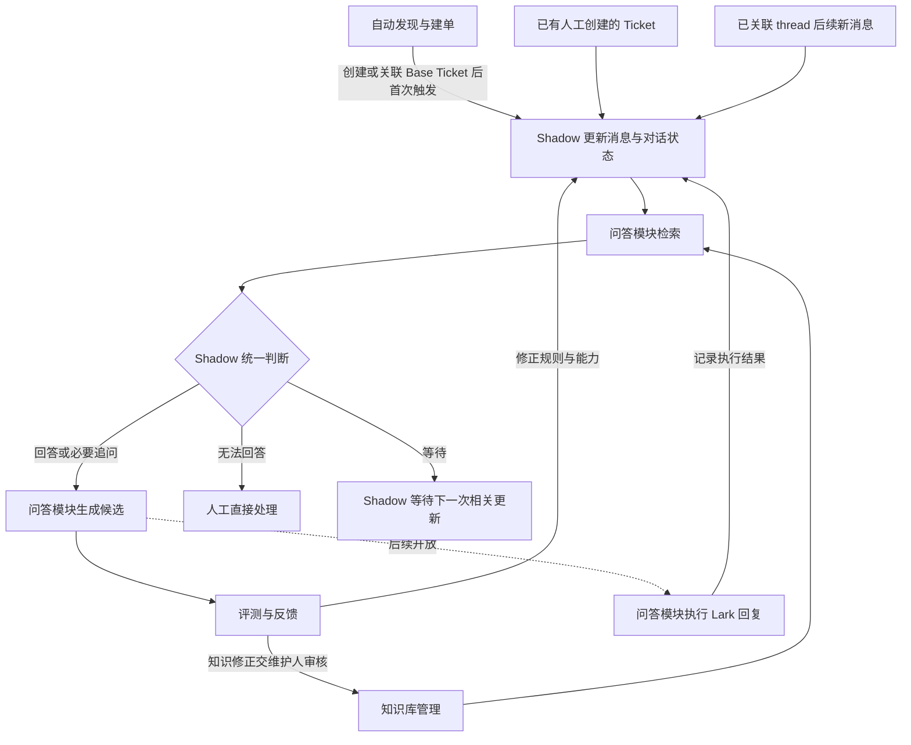

# Ticket AI / QA Agent 模块清单与研发顺序

## 1. 目标与已确认边界

目标是让 QA Agent 接入 Lark thread，理解问题、追问必要信息、回答有依据的问题，不能回答时由人工直接处理。先在后台分析、生成候选并验证质量，准确率与模块能力成熟后再开放自动追问和回复。

当前按以下六类模块/入口功能整理：

| 模块 | 核心职责 | 建设方向 |
| --- | --- | --- |
| 1. 自动发现与建单 | 发现新 thread → 创建/关联 Lark Base Ticket → 首次启动 Shadow | 补齐入口自动化；可独立，也可归运行控制与监控，最终归属未定 |
| 2. Shadow AI | 更新已关联 thread、维护对话状态、统一判断下一步动作 | 扩展现有 Shadow，作为判断核心 |
| 3. 知识库管理 | 管理知识内容、原始证据、适用范围与审核状态 | 复用现有知识基础，持续改善质量 |
| 4. 问答模块 | 内含知识检索（RAG）、回复生成、Lark 回复执行三个功能 | 属于同一个模块，先检索/生成候选，再开放发送 |
| 5. 评测与反馈 | 审核、标注、统计质量、收集修正与回归验证 | 独立模块，扩展现有 Eval 基础 |
| 6. 运行控制与监控 | 管理运行模式、开放范围、暂停、故障与运行指标 | 需要，但当前不开发；保留后续规划 |

人工协作与交接当前不建模块：人工沿现有方式直接处理，不开发派单、接单确认或超时升级系统。Shadow 可以记录“需人工处理/人工正在处理”，避免后续自动回复与人工冲突。

这些是职责划分，不代表新增六个服务、部署单元或页面。现有主站/Lark Ticket AI 页面可承载展示、人工使用与评测；已有身份、权限、平台同步、日志和受控写入作为共用基础复用，不再另列 QA 业务模块。

“现有功能”依据本次检查的工作区与既有任务记录；有代码不等于已部署或真实回复质量达标。工作区有其他 Wiki RAG 任务的未提交改动，其采用和验证状态以对应任务为准。本文是盘点与规划，不是实施授权或排期承诺；执行事实见[任务记录](../tasks/ai-ticket/2026-10-22-ticket-ai-qa-agent-capability-map.md)。

## 2. 各模块的现有功能与缺口

### 2.1 自动发现与建单

**现有功能**

- 用户确认：目前由 Support 从 Lark thread 手工创建 Lark Base Ticket。
- 创建后，Octo 已能同步 Ticket 字段、读取关联 thread，并在候选条件满足时进行后台 Shadow 分析。
- 已有 Lark adapter、身份/授权、平台同步及 Shadow 服务可复用；尚无已接通的“发现新 thread → 自动建单 → 自动启动 Shadow”完整入口。

**还缺的功能**

- 在约定范围内发现新的服务 thread，确定哪些需要建单；识别范围、触发条件及发现方式待设计。
- 查重和关联：识别已有人工工单，保存 thread 与 Base Ticket 关联，避免重复事件或重试造成重复建单。
- 按 Base 字段契约创建 Ticket，包含必要字段与原始 thread 链接；具体必填字段和默认规则待确认。
- 建单/关联成功后自动触发首次 Shadow，不依赖人工再操作或单纯等待现有批处理候选。
- 处理部分成功：已建单但 Shadow 启动失败时，只重试启动；建单结果未知时先核对，避免盲目重复创建。

**边界与顺序**：这项功能负责“进入系统”，Shadow 负责进入后的持续更新。可在后台分析期独立建设，不依赖自动回复；建议待首次分析入口与材料契约稳定后接入。不会因本次规划而实际创建工单，也不默认全量监听或回补历史 thread。这里创建的是 **Lark Base Ticket**，与既有创建 Meegle 工作项的功能不同。

依据：[平台同步存储](../../server/src/adapters/postgres/platform-sync-store.ts)、[thread 服务](../../server/src/application/services/lark-ticket-thread-context.service.ts)、[Shadow 服务](../../server/src/application/services/lark-ticket-shadow-summary.service.ts)。手工入口现状来自用户确认。

### 2.2 Shadow AI

**现有功能**

- 分析前调用 thread 服务，按缓存/同步策略读取根消息和后续消息；已有全量/增量同步、脱敏、回复关系、完整性与快照版本。
- 分析意图、关键词、问题总结、处理结果/方案与质量警告。
- 输出业务风险及依据、是否/何时回复的建议及消息证据，能结合 Wiki 检索结果进行分析。
- 保存独立的 `shadow_ai`，不自动对外回复；成功输出已有展示和 Eval 标注入口。

**还缺的功能**

- 响应入口首次启动，以及已关联 thread 的后续新消息。当前候选主要由 Ticket 源更新时间驱动，默认等待 3 小时、每小时轮询、每批 5 张，可配置，不能保证每条新消息都会触发。
- 持久化逐轮状态：当前诉求、已知事实、必要缺口、已问问题、收到的补充/纠正、待谁回应、最后处理消息及人工处理状态。
- 统一结构化动作：回答、追问、需人工处理、等待，并记录理由、证据与阻塞条件。现有回复时机建议尚不等于这套完整动作判断。
- 区分主问题不清与处理前提不足；避免重复追问、无限追问或忽略用户纠正。
- 以当轮材料版本保存状态和决策，处理并发与新消息到达后的旧结果；最新 `shadow_ai` 投影不能独自承担完整历史账本。

**边界与顺序**：沿现有 Shadow 扩展。原始消息仍由 thread 服务保存；Shadow 编排理解与判断，调用问答模块取得证据，并由问答模块生成具体文案。优先在已有人工创建的 Ticket 上完善，不必等待自动建单。

依据：[Shadow 服务](../../server/src/application/services/lark-ticket-shadow-summary.service.ts)、[候选与覆盖写入](../../server/src/adapters/postgres/platform-sync-store.ts)、[分析结构](../../server/src/domain/shadow-analysis.ts)、[规则](../../server/src/domain/shadow-summary-prompt.ts)、[消息准备](../../server/src/domain/support-ticket-analysis.ts)。

### 2.3 知识库管理

**现有功能**

- 已有 wiki 知识页、raw 原始材料和 Ontology；支持知识来源、环境、draft/confirmed 等状态与使用局限。
- Answer 可检索并注入人工批准的知识材料；Document 动作按既有 Skill 准备 raw、知识草稿及维护记录，Answer 提示词允许查询/缺口登记。
- 既有知识与摄入记录可作为质量维护基础；逐票 KCS 更新与使用已有设计。

**还缺的功能**

- 让候选生成与决策一致使用知识的来源、内容版本、适用环境、必要前提及审核边界。
- 完善过期、冲突、纠正和替代关系，避免同类症状被误当作同一处理方案。
- 把评测发现的知识缺口和人工修正交给维护人，审核后更新，再用相关样本回归。
- 区分“知识被引用”“实际采用”“用户确认有效”；AI 输出不能直接成为已验证知识。
- Wiki 预生成问题等增强需依据关联实验独立验证，不将规格或实验计划当作已落地。

**边界与顺序**：选定试点问题对应的可信知识先整理，之后贯穿研发持续维护。不要求先实施完整 KCS 数据表、自动摄入或全量历史重整，避免把知识平台改造变成首期前置。

依据：[知识存储](../../server/src/adapters/postgres/support-knowledge-store.ts)、[默认提示词](../../server/src/domain/workflow-prompts.ts)、[KCS 提案（未实施）](ticket-kcs-update-and-use-design.md)、[Wiki 增强任务](../tasks/ai-ticket/2026-10-22-wiki-extract-generated-questions-spec.md)。

### 2.4 问答模块

知识检索（RAG）、回复生成、Lark 回复执行是同一模块内部的三个功能。

| 内部功能 | 现有功能 | 还缺的功能 |
| --- | --- | --- |
| 知识检索（RAG） | Wiki 已有问题提取、本地召回、重排、原始证据筛选与来源限制，覆盖 Support Wiki/Ontology；Hermes Answer 另有 approved 知识注入路径；Shadow 已复用 Wiki retrieve | 对齐现有路径的证据输出，绑定当轮问题与知识版本，明确无命中、条件不足、冲突和历史参考；持续验证多语言问题提取/召回/证据质量，供 Shadow 统一判断 |
| 回复生成 | Wiki 可单次生成有引用边界的答案；Hermes 支持页面内多轮问答、流式结果、停止/恢复、工具审批与引用展示；已有回复草稿编辑/复制 | 按 Shadow 动作生成当轮答案或必要追问，统一内容/证据/局限与版本记录；补充后使用当前材料重新生成。Hermes 现有续聊沿用初始材料，不能直接当作自动更新的 thread 对话 |
| Lark 回复执行 | adapter 有发消息和 thread 回复接口，既有业务会推送 thread；通知 outbox 有幂等、claim、重试、失败和结果未知状态 | 把 QA 候选、许可和正确 thread 目标绑定；发送前核对新消息、材料版本及人工处理状态，拦截旧草稿；适配 thread 投递去重、结果未知处理及 messageId/read-back。现有通知信封只有群目标和文本，不能直接当作完整 QA 回复执行 |

**边界与顺序**：近期优先检索和生成，先形成后台候选并交评测。后续先验收人工确认发送，再限定场景自动发送。现有 Wiki/Hermes/发送 adapter 是可复用实现，不要求改成一个新的大文件或只保留一个 provider。知识相关性、模型自评分、答案列出来源均不等于回答已验证正确。

依据：[Wiki 服务](../../server/src/application/services/wiki-qa.service.ts)、[reader](../../server/src/adapters/filesystem/wiki-knowledge-reader.ts)、[AI 会话编排](../../server/src/application/services/lark-ticket-ai-session.service.ts)、[回答引用](../../server/src/domain/ticket-answer-sources.ts)、[Lark adapter](../../server/src/adapters/lark/lark-client.ts)、[既有 thread 推送](../../server/src/application/services/meegle-lark-push.service.ts)、[outbox](../../server/src/adapters/postgres/message-outbox-store.ts)、[投递 worker](../../server/src/application/services/message-delivery-worker.ts)。

### 2.5 评测与反馈

**现有功能**

- Shadow 成功输出按版本冻结，两端共用 Eval/Badcase、失败标签与原因、人工意图和期望结果；已有幂等与并发冲突保护。
- 主站/Lark 应用可查看、编辑标注及历史版本。
- 已有 FE Action 正常/坏例评测脚手架、确定性检查及可选模型裁判；fixture 默认禁用，不代表已有运行中的自动质量评测。

**还缺的功能**

- 从评价 Shadow 输出扩展为评价每轮决策、追问与实际候选回答；当前 Shadow 标注入口不评价 Wiki 单次回答或编辑后的回复草稿。
- 冻结当轮消息、字段、决策、实际证据和候选，并关联模型/提示词/知识/策略版本；保存原候选、人工修改和判定。
- 建立独立开发/验证样本及回归，覆盖正确回答、必要追问、应交人工、应等待、无知识和多轮纠正。
- 统计回答准确率、动作正确率、追问必要性/重复率、需人工处理判断及后续结果；保留失败和未知结果，不只收集主动标记的 Badcase。
- 将人工修正和知识缺口反馈给 Shadow 规则、问答能力和知识维护，并验证改进是否有回归。

**边界与顺序**：先建立最小评测口径与基线，再与 Shadow/问答共同迭代。候选采纳/修改/拒绝属于评测与反馈，不建设人工派单或交接系统；自动准入阈值、样本量和观察窗口仍需确定。

依据：[评测服务](../../server/src/application/services/lark-ticket-eval-dataset.service.ts)、[标注结构](../../server/src/domain/lark-ticket-eval-sample.ts)、[TEN-144](../tasks/ai-ticket/2026-10-21-lark-badcase-design.md)、[评测脚手架](../../evals/lark-ticket-ai/README.md)。

### 2.6 运行控制与监控

**现有功能**

- 项目已有身份/权限、结构化日志、actionRunId、定时 worker、AI 运行状态和手动停止等共用基础。
- 这些是现有技术能力，尚未组成完整的 QA Agent 运行控制与监控模块。

**后续缺口**

- 后台观察、人工确认发送、自动回复的运行模式，以及按群/场景限定开放范围。
- 暂停、恢复、故障降级和紧急停用；与人工处理状态协调。
- 自动任务的持久化、并发、重启恢复，以及失败/积压/结果未知的监控。
- 回复质量、模型失败率、响应延迟、调用量与成本等指标和异常发现。
- 若入口自动化归入本模块，单列发现、建单、首次启动的结果和失败处理。

**边界与顺序**：当前不开发该模块。保留后续需求，待后台能力成熟、准备开放回复时安排；自动发现与建单可以独立推进，不需要先完成整个监控模块。

依据：[worker 入口](../../server/src/scripts/platform-sync-worker.ts)、[AI 运行服务](../../server/src/application/services/web-ai-session-runs.ts)、[权限服务](../../server/src/application/services/acp-permission.service.ts)、[日志](../../server/src/logger.ts)。

## 3. 模块协作关系

自动发现和自动回复是两个不同的开放动作：入口可先自动建单并启动后台 Shadow，回复继续由人工处理。后续发送结果记录应推进处理状态，不能把自身发送事件当成新用户诉求而重复作答。

运行控制与监控在后续负责这些能力的运行策略和监测，本阶段不建设。全部业务编排与状态归 Server，平台调用留 adapter，FE 负责展示、人工使用与评价；新接口沿用 Zod、显式依赖和结构化诊断。

## 4. 建议研发顺序

建议先把已有工单上的后台质量流程做完整，再扩大自动入口，最后开放回复。已有人工建单数据足以启动前两步；入口自动化无需等到回复准确率达标。

| 顺序 | 研发内容 | 涉及模块 | 可核验的阶段产出 |
| --- | --- | --- | --- |
| 1. 建立质量基线 | 选择小范围问题和可信知识；确定评测口径，准备当轮材料与独立验证样本，先用现有能力跑基线 | 评测与反馈、知识库管理 | 能还原当时输入和实际证据；人工标准、样本与当前问题清楚，可比较后续版本 |
| 2. 完善后台判断与候选 | 在既有 Ticket 上扩展 thread 更新、对话状态、必要缺口和统一动作；问答模块返回证据并生成答案/追问；逐轮评价和修正 | Shadow AI、问答模块检索/生成、评测与反馈；知识持续维护 | 后台走通“问题→判断→候选追问→补充后重判→回答或人工处理”；不自动发送，能追溯每轮变化 |
| 3. 接入自动发现与建单 | 发现范围内新 thread，查重、创建/关联 Base Ticket，自动触发已稳定的首次 Shadow 入口 | 自动发现与建单、Shadow AI | 人工不再逐条建单；验证重复发现/人工已建单/结果未知/建单成功但分析启动失败。先静默分析 |
| 4. 验证人工确认发送 | 候选质量稳定后，补齐问答模块的 thread 执行和记录；每条回复或追问由人工确认 | 问答模块执行、评测与反馈 | 真实 thread 定位、去重、过期草稿拦截、人工处理冲突、失败与结果未知均有验证证据 |
| 5. 后续运行控制与监控 | 在准备扩大对外运行时安排模式、范围、暂停和监测能力 | 运行控制与监控 | 支持限定开放、发现故障、暂停与退回人工；本阶段暂不开发 |
| 6. 限定场景自动回复 | 各场景质量与执行稳定后，开放自动必要追问和有据回答；不能回答仍由人工直接处理 | Shadow AI、问答、评测、运行控制；复用知识与入口 | 在明确范围内达到已约定质量/运行条件，持续抽检；扩范围前重新评测 |

第 1/2 步可迭代交错；知识维护贯穿全部阶段。第 3 步可在首次 Shadow 触发及材料契约稳定后并行推进，不必等待所有答案完善。第 4–6 步为后续规划，当前不开放发送，也不启动运行控制与监控研发。以上顺序是建议，不是已批准的排期或应用实现任务。

## 5. 从后台到自动回复的质量条件

- **按当轮评测**：输入只包含当时可见的消息、字段和知识版本；不能把后续人工答案、最终解决方案字段或由同一测试票答案蒸馏的知识提前给模型。历史材料不完整时显式标记或排除，不能用最新字段伪造历史时点。
- **分别衡量**：候选/实际回答准确率、动作正确率、必要追问及重复率、应人工处理的识别率、覆盖率、用户确认效果及未知结果；不能以发送成功或无人再回复证明解决。
- **留出验证**：开发/验证按事件或问题簇隔离，版本变化后跑回归；知识相关性、模型自评分或结构校验通过均不等于回复正确。
- **先确认后自动**：首次开放发送前验证真实投递；自动模式前明确场景允许范围、质量阈值、样本数/置信区间、观察窗口与停用条件，不能凭少量样本零错误放行。
- **分别验证入口和回复**：入口看漏建、重复建、错关联及启动失败；回复看错误、重复、过期发送及投递结果未知；两者独立验收，不互相替代。

现阶段优先输出“当前问题、已知事实、必要缺口、下一步动作、候选内容、证据和材料版本”，由人评价后再逐步开放执行。人工直接处理的边界保持不变；完整 KCS、多模态/截图理解、业务数据修改、自动修复或部署均不默认纳入本期。

## 6. 复用的现有平台能力与验证边界

- Ticket 同步、列表/搜索/详情、属性与解决方案编辑、Meegle 创建/关联，以及主站/Lark 应用继续作为共用基础。[Ticket 服务](../../server/src/application/services/lark-ticket.service.ts)、[Lark 应用说明](../../fe/docs/lark-ticket-app.md)。
- 正式 Summary/Ticket AI 与 Shadow 的现有投影继续区分；`needs_info`、`escalated`、`autoResolvable` 只是分析字段，不代表追问、交接或自动处理已经执行。[正式分析服务](../../server/src/application/services/support-ticket-analysis.service.ts)、[分析结构](../../server/src/domain/support-ticket-analysis-update.ts)。
- 既有 effect draft 和确认层可复用权限/审计思路，但其类型是回答反馈和 Ticket AI 更新，不是现成的待发送 thread 回复。[草稿结构](../../server/src/domain/support-ticket-effect-draft.ts)、[确认服务](../../server/src/application/services/support-ticket-effect-draft.service.ts)。
- [Wiki RAG 当前采用任务](../tasks/ai-ticket/2026-10-21-wiki-rag-vendor-bill-diagnosis.md)记录本地采用及未部署边界；[核心问题与预生成问题任务](../tasks/ai-ticket/2026-10-22-wiki-extract-generated-questions-spec.md)记录实验准备/审核进度，不视为全部已落地。
- [TEN-144](../tasks/ai-ticket/2026-10-21-lark-badcase-design.md)有测试环境与用户确认记录；[Hermes 任务](../tasks/ai-ticket/2026-10-21-lark-hermes-answer-tab.md)有部署及部分真实问答证据，完整流程验收曾被用户停止；局部成功不能合并为 QA 自动回复链路已验收。

本次只重整项目文档和任务索引，核查引用及差异；不运行模型、不进行 Lark 写入、不部署应用。代码证据支持能力盘点，不证明生产运行状态或回答准确率达标。
