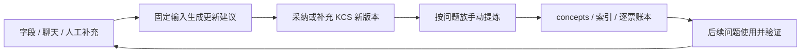

# Ticket KCS 更新与使用设计

本文是待实施设计。当前 Octo 尚未实现这里提出的 KCS 数据表、编辑交互、更新服务或查询消费；没有执行数据库迁移、调度接入或生产更新。评估依据、需求与验证进展见[任务记录](../tasks/ai-ticket/2026-10-13-wiki-kcs-optimization-assessment.md)。

## 1. 目标和边界

每张纳入范围的 Ticket 维护一份持续积累的 KCS 工作记录：保留症状、环境、检查、观察、处理、验证、原因与缺口，使他人能够接续处理。llm-wiki 保存跨票复用的知识，工作记录与知识页多对多关联。

第一版选择闭环：手动初始化 → 从已同步资料生成候选 → 人工补充或采纳 → 保存版本 → 手动按簇更新 wiki → 当前票问答使用 → 记录实际采用与效果。自动随同步更新候选、历史 KCS 搜索列为下一阶段。

KCS 试点可显式选入进行中 Ticket，以便及时记录；这不改变现有 wiki 默认批量 Finish 范围。未完成票只有在明确指定的摄入范围内形成 investigation / known_issue 等有边界知识，不自动当作可执行答案。

现有 Shadow 和 Summary 提供派生分析，可作为整理线索。KCS 独立记录人工补充、确认范围和版本，不把重复生成的分析计为新增证据。业务规则正文继续只维护在 wiki / 既有权威定义中。

### 1.1 原 Ticket、已有文档与当前实现的关系

逐票 KCS 工作记录是本项目为人工补充、过程整理和复核历史提出的实现选项。KCS 方法关注原始处理事件与可复用知识的关联，不要求额外复制一套工单。官方 [Linking](https://library.serviceinnovation.org/KCS/KCS_v6/KCS_v6_Practices_Guide/030/030/030/030) 将原始事件与知识关联为多对多，并要求保留实际交付时的知识版本。

| 资料 | KCS 中的处理原则 | 当前 Octo / wiki 已实现的处理 |
| --- | --- | --- |
| 原 Ticket 与聊天 | 原工单记录本次请求及处理；知识条目通过关联服务本票和后续请求 | 业务原记录继续在 Lark；Octo 同步字段与线程副本，不因知识提炼删除/替代原记录 |
| 同步副本与证据版本 | 保留足以追溯当时问题、条件和处理结果的记录 | 同步表 upsert 当前已同步值；线程内容变化推进 snapshotVersion，但该表本身不是完整版本档案。执行摄入后，raw/transcripts 追加不可变版本 |
| 已有知识文档 | 合适条目直接关联，复用中补条件/纠正；缺知识时建立条目。适合的现有参考文档可直接引用具体段落 | concepts 由手动 Document / write-support-qa 更新，sources / 正文回指 raw 或权威定义；不要求一票一文 |
| 工单与知识的关联 | 区分解决依据与参考资料，并记录当时版本 | 逐票账本已有主要路径和处理状态，知识页有来源链接；完整 knowledge_refs 尚需消费者同步，不能视为已接通实际复用统计 |
| 旧文档 | 对旧知识库可保留只读检索入口，按实际需求重整有用内容 | 既有 concepts 沿用并逐步复核；docs/support-qa/knowledge-index.jsonl 已停更，不作当前查询权威。odoo-lark-wiki 是导出来源目录，不是当前 reader 直接扫描的知识根 |
| 查询与反馈 | 在处理时搜索/使用并改进，追溯使用版本和结果 | 独立 Wiki 问答读取 concepts / 可选 Ontology，ACP Answer 使用另一份 approved 注入材料并按权限读 wiki；尚未接通拟议的逐票 KCS/usage 自动闭环 |

历史文档采用需求驱动整理的建议来自 KCS [Dealing With Legacy Data](https://library.serviceinnovation.org/KCS/KCS_v6/KCS_v6_Practices_Guide/030/040/010/045)，原文对象是旧知识库；应用到旧 Ticket 属于本项目适配，不能直接当作全部工单迁移策略或用原文比例估计本库价值。

采纳本设计时继续保留现有 Lark 数据、raw、concepts 与已发生的确认记录。按选定范围逐步补 KCS/关联和适用性，不把所有旧票全量重生成、不因低复用批量删除旧文章。旧页面过时或重复时保留历史依据及替代入口；导出来源若要用于问答，需要按现有来源摄入/知识整理契约接入。

## 2. 保存位置与所有权

| 内容 | 权威位置 | 使用方式 |
| --- | --- | --- |
| Ticket 源字段和线程 | 现有同步表；固定取证材料按现有机制保存不可变快照 | 原始证据；保留来源、同步时间和完整性 |
| 本票 KCS 工作记录 | 拟新增的 Octo KCS 存储 | 本票事实、过程、补充说明和待办；支持修订历史 |
| AI 更新建议 | 拟新增的 KCS proposal 存储 | 在固定输入上产生的候选差异，不直接替换当前记录 |
| 通用知识 | wiki concepts / 已有业务权威文档 | 按实际用途更新现有文章或新增场景页 |
| wiki 摄入状态 | wiki _meta/state.jsonl | 逐票摄入版本、复核状态和知识关联；不复制正文 |
| 实际使用事实 | 拟新增的 KCS usage 存储 | 使用了什么版本、采取了什么动作、结果依据；wiki log 链接维护事件 |

没有 KCS 记录的 Ticket 继续按现有流程工作，不为了覆盖率批量创建空记录。没有足够证据也可保存调查信息；不要求每张 Ticket 单独生成文章。

## 3. 一份 KCS 记录的内容

每份记录绑定 `baseId + tableId + recordId`，票号只用于展示。单票含多个不相关问题时，使用稳定的 `issueId` 分段；第一版默认一段，不按每次模型输出重新分配已有段落 ID。

| 区块 | 保存内容 |
| --- | --- |
| 问题 | 用户原话、具体症状/报错、希望完成的任务及业务用语 |
| 环境 | 已知公司/渠道、版本、业务入口、单据状态和必要配置；未知显式保留 |
| 检查过程 | 检查动作 → 观察结果 → 下一步；保留失败尝试和排除依据 |
| 实际处理 | 已执行的改动、执行/报告时间、结果；建议动作单独标注 |
| 验证 | 处理人报告、用户复测或独立场景验证、验证范围及证据 |
| 原因 | 假设、已确认原因、未知项；不从症状相同推断同根因 |
| 缺口 | 缺什么、阻塞哪项判断、下一步要查询或验证什么；责任和日期仅记录实际约定 |
| 知识关联 | wiki 稳定路径、段落及内容版本，区分 supports、related、used |

每个重要条目有稳定 `itemId`，以及以下共同属性。引用和确认针对条目，不给整张票一次性盖“全部正确”的章。

| 属性 | 契约 |
| --- | --- |
| `kind` | problem / environment / check / observation / action / verification / cause / gap |
| `content` | 脱敏结构化内容；步骤可以关联前一步 itemId |
| `origin` | source_extract / human_note；作者由服务端认证身份确定，AI 不能指定自己为人工 |
| `assertion` | source_statement / human_attestation / hypothesis / suggestion；来源中的一句话仍只是该来源的陈述 |
| `evidenceRefs` | 固定输入中的字段、消息、人工说明或可追溯记录；来源 ID + 版本 + 定位，不只存一个链接 |
| `review` | unreviewed / human_reviewed，附确认人、时间和范围；确认可表示原文支持本条陈述，不自动确认根因 |
| `validity` | usable / needs_review / contested / superseded；只表示当前条目的使用边界，不替代文章适用状态 |
| `supersedes` | 实际替代的旧条目/版本；纠正保留旧记录 |

处理结果沿用 wiki 语义：`unresolved / workaround / reported_fixed / verified_fixed / not_applicable`。根因独立用 `unknown / hypothesis / confirmed / not_applicable`。`verified_fixed` 必须有明确的复测/场景验证证据与范围；Ticket 为 Finish、处理人写“已处理”或用户停止回复均不自动触发。

文章的 draft / confirmed 仍由 wiki 的签核契约控制；人工复核本票记录不自动批准整篇文章。当前适用性也不能由一个高置信度分数决定。

## 4. 存储模型（拟新增，未建表）

第一版建议四个对象；具体 migration 和 JSON DTO 在实施时按本契约评审。复用现有 PostgreSQL、认证、模型 client 和 run 追踪，不引入新依赖。

| 对象 | 关键字段 | 约束 |
| --- | --- | --- |
| `ticket_kcs_records` | id、Ticket 三元组、headRevisionId、headVersion、createdBy、createdAt | 三元组唯一；head 指向当前已提交记录，首次人工初始化可没有条目 |
| `ticket_kcs_revisions` | id、kcsId、version、parentRevisionId、changeKind、payloadJson、sourceFingerprint、evidenceBundleJson、semanticDigest、actorId、actionRunId、createdAt | `(kcsId, version)` 唯一；已提交内容不可修改，更正生成新版本；changeKind 区分 human_edit / proposal_apply / source_invalidation |
| `ticket_kcs_proposals` | id、kcsId、baseRevisionId、inputFingerprint、sourceFingerprint、inputSnapshotJson、promptVersion、schemaVersion、model、patchJson、state、errorCode、actionRunId、createdAt | 候选不推进 head；input/patch 一旦写入保持不变；运行与采纳状态可更新，部分采纳记录 item 处置清单 |
| `ticket_kcs_usages` | id、Ticket 三元组、kcsRevisionId、wikiRefs、contextSnapshotJson、adoption、effect、evidenceRefs、actorId、supersedesUsageId、actionRunId、createdAt | 追加使用事实；更正追加新行，按最新有效事件统计，不重复计数 |

`inputSnapshotJson` 保存模型实际看到的脱敏字段、完整消息块及省略说明，不能事后从已变化的同步表重建。revision 的证据可引用这个不可变输入或保存具名人工补充；保留查阅授权和来源限制。完整聊天按既有证据机制留存，工作记录只摘取必要信息。

`sourceFingerprint` 使用稳定白名单字段和规范化 prepared_messages 内容计算，包括文本编辑/删除；同步检查时间不参与内容哈希。KCS 白名单需包含问题描述、状态、解决方案及确实参与判断的字段，不直接沿用现有仅部分源字段的哈希而假定覆盖所有输入。

`inputFingerprint` 另包含 baseRevisionId、实际呈现材料的哈希、schema/prompt 版本；输入省略或清洗策略变化可区分。`semanticDigest` 仅覆盖条目、证据、适用边界与确认，排除查看次数、同步检查时间及推荐曝光，避免无内容变化时反复提炼。

本设计不复用 `support_thread_results.review_status` 等字段来冒充逐票 KCS 版本。现有分析持久化可以供整理读取，但其 upsert 机制不能直接承担不可变修订历史。

## 5. 怎样更新记录

### 5.1 更新触发

| 触发 | 第一版行为 | 是否改变当前 KCS |
| --- | --- | --- |
| 用户首次点击“建立处理记录” | 绑定 Ticket，建立初始 head，读取当前源材料 | 初始化记录；不虚构任何处理事实 |
| 点击“从最新资料整理” | 固定已同步材料和当前 head，生成候选差异 | 只新增 proposal |
| 人工补充或纠正 | 保存说明、来源与确认范围，产生新 revision | 改变 head |
| 选择采纳 AI 条目 | 校验候选、来源及基线，将所选差异合并为新 revision | 改变 head；未选条目继续待核对或明确驳回 |
| 源证据被更正/删除 | 使依赖它的条目待复核，保留文字与旧确认记录 | 生成状态失效 revision；不自动改写人工结论 |
| 记录采用及效果 | 写 usage，必要时人工转成新的验证说明 | 单独写 usage；不因曝光/反馈计数改变正文版本 |
| 同步发现变化 | 下一阶段仅对已启用记录标记候选待更新并合并触发 | 自动产候选仍需单独实现；不自动采纳 |

### 5.2 AI 整理的具体步骤

1. 检查读取权限，取得 head、源字段、线程快照和新补充。把输入绑定到一个固定包；模型调用前保存可重放的脱敏输入。
2. 相同有效输入且已有可用候选时复用；已失败的运行可显式重试。仅同步时间变了不再次生成。
3. 模型输出有限的 `add / propose_replace / propose_supersede / identify_gap / flag_conflict`。输出只引用已呈现的证据 ID；不能通过模型输出直接删除历史或标记人工确认。
4. 服务端校验 DTO、证据 ID、原文定位、条目 ID、来源版本及输出大小；Shadow 摘要、候选文本和模型回答不登记为原始证据。
5. 保存 proposal，展示新增事实、与当前记录不同的内容、缺口及冲突。无法读取线程时保留不完整标记，只整理已有字段/人工说明，不把它当作完整聊天证据。
6. 人工可采纳部分条目、修改后采纳或驳回。AI 候选可以帮助协作和追问，尚未采纳内容始终显示待核对，不成为现场已验证事实。

推荐 UI 只突出需要判断的差异，例如“新增复测结果”“与已确认原因矛盾”“仍缺环境”。不要求处理人每次重审整票、重复填写已知内容。

### 5.3 人工补充和采纳

所有变更携带 `expectedHeadVersion`、`expectedSourceFingerprint` 和幂等键。服务端事务中核对当前 head 与已知来源，再创建 revision 并推进 head；模型请求在事务外执行。

人工说明保存填写人、时间与声明范围，可以引用日志、操作记录或具体消息。只确认“处理人报告恢复”时，条目仍表达这个报告，不升级为当前根因或跨环境方法。

AI 候选生成期间发生人工编辑或资料变化，候选变为 stale。采纳时返回版本冲突，保留候选并基于新 head 重新整理；不静默覆盖新编辑。只采纳所选差异，其他人工内容完整保留。一次部分采纳后 head 已变化，未选建议保留为旧候选的待办；后续采纳须基于新 head 重新整理/显式重建候选，不能继续套用旧基线。

幂等键绑定用户、Ticket、操作及请求内容。同一键同一请求返回同一结果；同一键不同请求拒绝；重复点击不产生两个版本。提交版本递增由数据库事务和唯一约束保证。

### 5.4 来源变化后的复核

保存时和读取供问答时，都检查条目依赖的来源是否仍可定位。已知引用消息被编辑/删除、字段发生冲突或出现明确纠正时，将相应条目标记 needs_review / contested；旧版本继续可追溯。

新消息本身不使所有旧事实失效；按来源依赖标记受影响条目。无法程序化判断冲突时生成待核对提示，不能声称已完成语义复核。后台尚未写入失效 revision 时，读取投影也必须保守限制受影响条目，防止更新时间差导致旧结论继续作为现行依据。

同步表反映的只是已观察状态。现有 `decideLarkTicketThreadSync` 对终态且可用完整快照直接用缓存，不能凭“整理 KCS”就宣称已重新检查飞书最新消息。第一版显示字段/线程各自的资料时间和完整性；需要实时核对时另实现有授权的强制源复查，复查失败保留旧版本及 stale 状态，不推进成功检查时间。

## 6. 服务操作契约

以下是待新增的 application service 操作名，不是可调用 HTTP 地址。实施时在现有 Lark Ticket 模块注册 routes、Zod DTO 和路由测试；本文不把未注册接口写成现有能力。

| 操作 | 关键输入 | 输出/副作用 |
| --- | --- | --- |
| `getKcs` | Ticket 标识、操作者 | 当前 revision、候选摘要、资料时间/完整性、冲突提示 |
| `createKcs` | Ticket、幂等键、actionRunId | 初始化或返回已存在记录 |
| `proposeKcsUpdate` | Ticket、expectedHeadVersion、幂等键、actionRunId | 固定输入的 proposal；运行失败保留错误状态，head 不变 |
| `saveKcsEdit` | Ticket、expectedHeadVersion、expectedSourceFingerprint、typed changes、幂等键、actionRunId | 校验后产生人工 revision；identity 从 Session 解析 |
| `applyKcsProposal` | proposalId、expectedHeadVersion、expectedSourceFingerprint、selectedChangeIds、人工修订/说明、幂等键、actionRunId | 部分或全部采纳，产生一个 committed revision |
| `dismissKcsChanges` | proposalId、changeIds、理由、幂等键、actionRunId | 记录候选处置，不修改知识正文 |
| `recordKcsUsage` | Ticket、所用记录/文章版本、采用/效果、证据、幂等键、actionRunId | 追加使用事实，校验主体与可访问来源 |
| `exportKcsEvidence` | 授权 Ticket 范围、固定 revisionId | 只读、不可变取证包；不自行写 wiki |

沿用 Web Session 身份与当前 Ticket 数据读写权限；跨票查询仍受同一可访问数据源范围限制。客户端不能指定任意用户身份、任意 workspace/文件路径或通过请求体把 AI 来源提升为人工。

返回遵循现有 `{ ok, data, error }`；错误带 actionRunId、layer、module、stage、errorCode。拟定主要错误：`KCS_VERSION_CONFLICT` / `KCS_SOURCE_CHANGED`（409）、`KCS_EVIDENCE_INVALID`（400）、`KCS_ACCESS_DENIED`（403）、`KCS_NOT_FOUND`（404）、`KCS_GENERATION_FAILED`（模型阶段失败）。响应不含连接配置、原始敏感异常或不必要的完整平台 payload。

## 7. 怎样用于增量更新 llm-wiki

1. 候选由线程/字段内容变化、KCS semanticDigest 变化、规则变化或未完成待办产生。相同内容且上次工作完成才跳过；不能因为 record_id 已在账本或旧 raw 没变就忽略新的 KCS 补充。
2. Skill 选择同问题族 10–15 张，固定每张票的 KCS revision 与源快照，逐票阅读。AI 候选可提示缺口；可执行知识的关键结论须有直接证据与适用范围，不把候选建议写成既定操作。
3. 导出 KCS 证据包为拟新增的 `raw/kcs/<kcsId>/<revisionId>.md`，一次写入不覆盖；标明 `source_type: octo_kcs`、原始 Ticket、KCS 版本、快照哈希以及实际作者/确认范围。导出的 `sha256` 锚定规范化的 KCS 证据包内容（包含条目、出处、作者和确认范围，排除生成时间及展示包装），不沿用 transcript 的线程正文哈希语义。原始聊天继续引用 transcripts 里的实际版本。
4. KCS 导出中的 AI 摘要标为派生内容；原文摘录和人工补充保留各自来源。人工补充可以支持“某人作出该声明”，独立操作/验证依据按实际补充；不能把整个 KCS 文件一概当作已验证原始事实。
5. 按现有七种用途更新已有 concepts 或新增文章。只有线索时可形成 diagnostic 的有边界检查、historical_case 或 investigation，不编造创建/修复步骤。通用业务政策仍引用权威位置。
6. 逐票账本拟新增 `kcs_revision_id`、`kcs_semantic_sha256`、`kcs_raw_path` 和 `kcs_ingest_stage: pending / raw_saved / knowledge_saved / validated`；validated 仅表示本次摄入核查完成，不代表人工签核。保留原字段及 decision_history。它仍是 wiki 摄入状态权威，数据库不再存一份独立 wiki 完成状态。
7. 先完成证据落盘，再写知识及索引/日志，验证引用后才标记本次复核完成。文件写入与 DB 不具有全局事务；失败保存具体阶段和版本，恢复时核对已写文件哈希，不伪造整批成功。
8. 处理中出现 KCS R+1 时，本批只登记实际读取的 R，R+1 留在下一轮；原文/人工签核未完成的部分保持待办。新文章默认 draft，摄入结束不自动 confirmed。

`raw/kcs`、source_type、账本扩展均为提案。实施必须同步 guide 的 Schema、write/query Skill、取证脚本，以及 Server reader 的 raw 路径/证据解析与相应权限策略。当前 reader 只按既有来源类型提取证据，只增加目录不会使 KCS 被正确消费。Octo 单票入口仍绑定本票；批量导出在具备相应范围权限的 workspace 执行。

生产和测试目前共用 wiki 根目录。设计验证与对照使用固定版本副本；接入实际知识更新时明确目标 workspace 和发布范围，不把试验改写直接混入共用知识。

## 8. 怎样用于回答和继续排查

### 8.1 当前票 KCS

服务端在固定本次 Ticket 快照时，同时绑定一个 KCS revision，形成有用途标记的上下文：

| 材料 | 能支持什么 | 限制 |
| --- | --- | --- |
| 当前原始字段/消息 | 本次已观察到的现场信息 | 提供资料时点；缓存不证明最新状态 |
| 当前 KCS 的有效已复核条目 | 本票过程、已有判断、复测与补充 | 带 item/source 引用和确认范围；新冲突优先显示 |
| 未核对候选、假设、建议 | 下一步调查线索和必要追问 | 明确待核对，不能作为已执行动作或已确认原因 |
| concepts / 权威文档 | 可复用方法与业务规则 | 核对条件、版本、证据及文章适用状态 |

第一版接入独立 Wiki 问答入口，使用 `createWikiQaService` 的取材链路；保留现有召回、证据及引用检查。KCS 属于新增的本票事实输入，不接通旧 approved 数据库作为 Wiki 的替代知识源。ACP Answer / Shadow 的 KCS 消费另行实现，不能因共用 Ticket 页面就宣称都已接通。

上下文保留实际用于判断的 KCS 条目、冲突、限制和必要证据，而非整份记录无差别拼入。关键条件或纠正无法进入预算时，明确缺口并降为待确认；不得只留下成功动作。候选重排分数不能代替当前适用性核验。

回答使用 Server 分配的来源编号，并能回到“该票的具体条目及版本”或“知识页的具体证据”。本票 KCS 与知识资料由同一 Server 引用注册表分配唯一编号并保留来源类型；不把一篇知识页的编号复用为未提供的 KCS 条目。保留最多三篇 Wiki 资料的现有限制，KCS 条目另按实际上下文预算选取。最终至少能判断：可直接答复、相似历史线索、缺关键事实、无可靠依据。引用编号存在只证明引用合法，不证明结论正确；内容正确性仍须复用评估。

### 8.2 历史 KCS（下一阶段）

在知识页不足或需要案例对照时，再在授权范围内按症状、环境、对象和条件搜索旧记录。检索候选返回匹配点、差异、版本、结果与确认范围，不只返回“相似度高”。

旧 KCS 默认作为 historical_hint：解释曾检查什么、观察到什么、还缺哪些信息。只有被已核对知识及当前前提支持的方法，才进入当前操作建议；旧票解决不证明本票同根因，调查记录也不能被当作现成修复指南。

历史记录可以帮助发现问题族和补证对象。相似票全部无答案时，输出问题/缺口地图；不通过票数把假设升级为确认原因。

### 8.3 使用反馈

UI 在用户实际使用后提供“已采用”“有效 / 部分有效 / 无效 / 已升级 / 未知”的记录入口，支持简短说明及证据。只推荐或打开文档保持 recommended，不能自动记 used；未知结果保持 unknown。

usage 绑定使用时的 Ticket 快照、KCS revision、知识页路径/段落/内容哈希，同时保存实际供模型使用的脱敏相关片段、限制及最终答复到不可变 contextSnapshotJson，避免文章后来改写后无法解释当时答案；仅保存路径/哈希或依赖默认关闭的诊断日志不足以重放当时依据。问答完成可先登记 recommended，用户明确实际采用后再追加 used 及效果。新反馈暴露实际事实时，由处理人确认并作为 KCS 新补充；反馈计数本身不触发无限的 KCS → wiki → KCS 循环。

涉及外部反馈写入继续走现有明确授权及受控通道；本设计的本地使用记录不会自动回写 Lark、Meegle 或修改工单状态。

## 9. 用户交互

Ticket 详情增加“处理记录”区域，默认呈现问题/环境、已做检查、处理与验证、待补信息、关联知识。普通视图展示资料时间及“待核对/存在冲突”；版本 ID、哈希和运行信息放在诊断详情。

主要操作为“从最新资料整理”“补充/纠正”“采纳所选更新”“查看历史”“记录使用结果”。AI 生成后，按新增、修正、冲突分组显示差异；保留人工内容，提供逐项选择，不用一个整体覆盖按钮替换整票。

没有最终答案时允许保存和协作，不要求填写虚假的根因或解决方法。缺口列表优先展示阻塞判断的少量问题；问答每次选最必要的追问，不重复问已经有依据的信息。

## 10. 示例（虚构流程，非现有工单结论）

| 时点 | KCS 更新 | wiki / 问答怎样使用 |
| --- | --- | --- |
| R1 | 用户报告“退货时等级列表为空”；环境未知 | 保存症状，询问必要环境/关联产品，不生成创建 SKU 步骤 |
| AI 候选 | 新资料提示可能缺少对应 R-SKU | 标假设和待查项；不把候选当作已经查明 |
| R2 | 处理人补充“本单未查到对应 R-SKU”，附查询记录；确认范围为本单 | 可保留该场景的检查线索；通用创建/查重流程仍需权威依据 |
| R3 | 实际处理有记录，用户明确复测恢复，注明范围 | 更新本票验证；相关知识可补有边界案例，根因是否确认单独判断 |
| R4 | 后续纠正称此前查错了产品，原 R-SKU 其实存在 | 保留恢复结果及旧版本，撤回不成立的原因依据；关联知识标争议/待核验，回答不继续推荐按错误原因创建 SKU |

## 11. 实施顺序与验收

第一阶段：上述人工触发的端到端闭环，包括不可变版本、差异采纳、来源核对、KCS 证据导出、手动 wiki 增量、单独 Wiki 问答取材和本地使用结果记录。先选一个问题族，在隔离数据/知识副本验证。

第二阶段：在已明确的记录范围内，接同步变化产生候选、合并重复触发、带退避重试；再接历史 KCS 检索和其他问答入口。没有配置/实现前不描述为自动更新，也不默认对全量 Ticket 运行模型。

| 验收场景 | 应得到的结果 |
| --- | --- |
| 只有问题，没有答案 | 可保存症状/环境/缺口，未出现编造方案 |
| 无线程或线程不完整 | 保留材料不足；仍可保存人工说明；不标完整证据 |
| 同一输入重复整理/同一请求重复提交 | 不重复生成有效候选或 committed revision |
| AI 候选基线之后有人工编辑 | 采纳冲突，已有内容不被覆盖 |
| 模型引用未呈现消息、伪造人工身份或生成结果失败 | 拒绝候选/保持 head；记录安全错误 |
| 只采纳一部分变更 | 只提交所选差异，其他条目明确待核对/驳回 |
| 源证据被编辑、删除或否定 | 受影响结论限制使用，保留旧版本与旧确认范围 |
| Finish 之后有补充但源端未复查 | 不宣称最新；复查机制生效后才处理新源版本 |
| 线程/字段不变，但人工补充了 KCS | 进入 wiki 增量候选 |
| wiki 写到一半失败、或过程中 KCS 再更新 | 按实际阶段恢复；只登记已读取版本，不假装完成最新版本 |
| 旧票有成功记录但本票条件未知 | 给历史线索和必要追问，不输出确定根因/修复 |
| 阅读/引用文章但没有实际采用 | 仍为 recommended；没有虚增复用成功 |
| 越权读取另一数据源或传入任意文件路径 | 服务端拒绝，无敏感资料进入模型/日志 |
| 一组独立问题的复用检验 | 分别记录预期依据召回、条件完整、结论/下一步正确性及人工总耗时 |

上述是未来测试与人工评估要求，本设计任务未执行这些功能测试。实施时分别报告单元、mock integration、模型回放、live E2E 和生产验证。

## 12. 文档怎样维护

本文件是 KCS 更新与使用协议的单一设计入口。讨论改变字段、版本、确认或消费规则时修改对应章节并递增 design_version；[任务记录](../tasks/ai-ticket/2026-10-13-wiki-kcs-optimization-assessment.md)维护 requirement_version、决策、进度和验证边界，不再复制一整套字段设计。

每票过程写进其 KCS 记录；通用知识在 concepts 维护；原始证据追加 raw；逐票提炼状态在 state.jsonl 维护。不会把真实工单事实、客户资料或每次处理结果追加到本设计文档。

实施中契约变化需同步实际 DTO/存储、guide Schema/Skill、当前技术对象文档及对应测试。仅当实现及必要验证完成后，更新相关能力状态；draft 文档不是部署证明。

## 13. 已核对的实现入口

- [Ticket 同步 store](../../server/src/adapters/postgres/platform-sync-store.ts) 与[线程 store](../../server/src/adapters/postgres/lark-ticket-thread-sync-store.ts)：同步副本 upsert 当前值，取证快照历史另由 raw 保存。
- [Support Ticket Analysis service](../../server/src/application/services/support-ticket-analysis.service.ts) 与[存储](../../server/src/adapters/postgres/support-ticket-analysis-store.ts)：已有固定快照/证据校验和分析投影；KCS 可借鉴其服务边界，不冒充已有版本库。
- [线程上下文 service](../../server/src/application/services/lark-ticket-thread-context.service.ts) 与[共享输入构造](../../server/src/domain/ticket-thread-ai-context.ts)：保留当前完整性、时间、短引用和省略边界，注意终态缓存。
- [Wiki QA service](../../server/src/application/services/wiki-qa.service.ts)、[知识 reader](../../server/src/adapters/filesystem/wiki-knowledge-reader.ts)、[Ticket 使用入口](../../server/src/application/services/lark-ticket-ai-session.service.ts)：消费 KCS 及新证据类型均需显式接入。
- [Ticket controller](../../server/src/modules/lark-ticket/lark-ticket.controller.ts)、[Server 分层规则](../ai-dev/rules/server-code-rules.md)、[跨层规则](../ai-dev/rules/system-boundaries-and-code-rules.md)：沿用 Session、权限、DTO、显式依赖和诊断规范。
- [wiki Schema](/home/deploy/projects/odoo-eu-guide/docs/llm-wiki/SCHEMA.md)、[write-support-qa](/home/deploy/projects/odoo-eu-guide/.agents/skills/write-support-qa/SKILL.md)、[query-support-qa](/home/deploy/projects/odoo-eu-guide/.agents/skills/query-support-qa/SKILL.md)：知识用途、来源和人工审核的现行契约。
